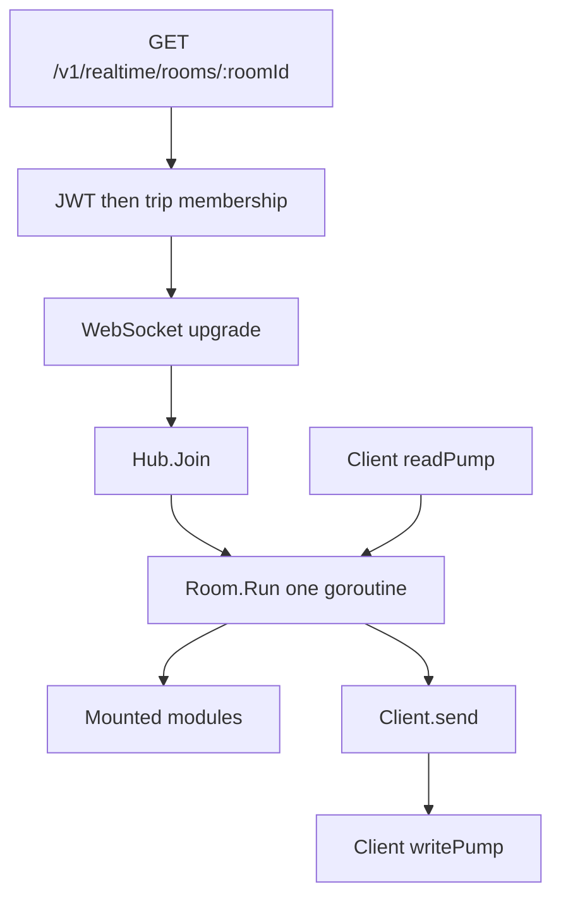

# Realtime rooms

The WebSocket runtime for a live trip. Tracking is mounted today; other domains can be added as modules. Off-route detection, lives, and redirect rules are in [tracking deviation](tracking-deviation.md). Checkpoint recovery and worker operations are in [tracking streams](tracking-streams.md). The original sketch walkthrough is [research material](research/road2d_websocket_main_explanation.md), not the current protocol specification.

## What this package owns

`module/realtime` is the connection runtime only:

- one room per id, one goroutine owns that room
- one live socket per user; a new socket replaces the old one
- read and write pumps, ping/pong, a bounded send buffer
- namespace routing of client messages into a `Module`
- presence, direct send, ordered broadcast, and a lossy latest-value batch
- bounded prepared server-event delivery and acknowledged user eviction
- per-hub idle timeouts and optional periodic ticks

It does not know routes, lives, branches, or chat. Those are modules mounted onto a `Hub`.

## Shape



`cmd/server/run` builds one `Hub`, mounts `tracking.NewTrackingModuleWithRecovery`, and passes the hub to `LobbyController`. Each room gets its own `TrackingCoordinator`; checkpoint writing, redirect publication, and result consumption are shared background workers inside the server. A separate `worker` process consumes Redis redirect jobs and calls Goong.

A room id is an opaque string. The lobby authorizer treats it as a trip UUID and allows an active member. A future chat room needs its own authorizer; do not teach `Hub` about trips.

User ids are `uuid.UUID`, the same id as `users.id`. The research sketch used `int64` only because its dev handler parsed a query param.

## The one rule

Only `Room.Run` may touch room state (`clients`, `byUser`, `latest`). Pumps talk
to the room through `register`, `unregister`, and `inbound`; server publishers
and eviction callers use the bounded `control` queue. A `sync.Once` coordinates
the shutdown signal without letting callers change client or module state.

A `Module` is called on that same goroutine. It must not:

- take a lock to protect its own room state
- call the database or another HTTP API inline
- call back into `Hub` from its factory, or start a goroutine in the factory
- call `Session` outside `OnJoin`, `OnLeave`, `OnMessage`, and `OnTick`

`Session` is the only handle a module gets. Tests fake that interface; they do not spin a room.

A full send buffer means a slow client. The room closes that socket immediately
and does not run `OnLeave` inside the send. The read pump unregisters, and
`OnLeave` runs on a later turn. A module is never re-entered from inside its own
callback. Closing the transport also prevents queued frames draining after an
explicit eviction has been acknowledged.

## Wire protocol

Client to server:

```json
{"type":"tracking.position","payload":{"lat":10.1,"lng":106.2,"batteryPercent":84,"signalDbm":-74}}
```

`type` is `namespace.command`. The room strips the namespace and delivers `command` plus the raw payload to that module. A type with no dot is `system.error` / `invalid_type`. An unknown namespace is `unknown_namespace`.

Server to client:

```json
{"type":"tracking.success","payload":"Welcome back"}
```

| type | when | payload |
| --- | --- | --- |
| `system.presence` | a user actually comes online or goes offline | `userId`, `online` |
| `system.error` | this socket sent a bad frame | `code` |
| any type passed to `Broadcast` or `Send` | immediately, in order | module-defined |
| `<type>.batch` | once per 500ms tick | `[{key, value}]`, newest value per key |

Presence is edge-triggered. Replacing a still-registered socket does not emit another `online`, and the replaced socket does not emit `offline`. Reconnecting after a real disconnect emits `online` again. The tracking snapshot sent from `OnJoin` lets the new socket catch up in either case.

`BroadcastLatest` is an available lossy path. Current tracking uses ordered `Broadcast` for its `tracking.positions` array on each tick and for life, off-route, and redirect changes. Delivery is bounded by the socket send buffer; broadcasts are not a durable replay log.

JSON fields on this socket are camelCase (`userId`), matching the rest of the API.

## HTTP entry

`GET /v1/realtime/rooms/:roomId`

1. If `Authorization` is missing and `access_token` is present, middleware moves the query value into `Authorization: Bearer` and strips it from the request URL before application request logging. Browser sockets cannot set that header. Prefer the header from native clients; upstream proxies may still log the original URL.
2. The existing JWT middleware runs, still before the upgrade.
3. `activeTripMemberAuthorizer` requires an active trip member. Anyone else gets 403 and the socket is not upgraded.
4. The connection is upgraded and `Hub.Join` starts the pumps.

`CheckOrigin` currently allows every browser origin. Restrict it to the app origin before this route is exposed beyond local development.

Mount every module before the process accepts connections. A room created earlier does not see a factory registered later.

JWT validation runs at the handshake only. Expiry does not currently close an established socket. Reconnecting with an expired access token returns HTTP 401 before upgrade. Automatic expiry close and token refresh are not implemented in the socket runtime or simulation clients.

## How to add a module

1. Put live domain behavior in its own package (`module/tracking`, later
   `module/chatting`). Persistent conversation logic lives in
   `module/conversation`. Do not add domain fields to `Room`.
2. Implement `realtime.Module`. One factory call builds one instance for one room. Keep the room's state on that struct.
3. `OnJoin` must be idempotent. Send the snapshot there with `Session.Send`.
4. `OnLeave` runs only for a real disconnect.
5. `OnMessage` receives the command with the namespace already removed.
6. `OnTick` uses the hub's interval: by default 500ms, including while empty
   until the five-minute idle timeout. A hub with ticks disabled never calls it.
7. In `cmd/server/run`, before the HTTP listener starts:

```go
if err := hub.Mount("yourNamespace", yourModuleFactory); err != nil {
    return err
}
```

The namespace is the prefix on the wire (`tracking.position`). Do not mount `system`, an empty name, or a name that contains a dot.

Outbound type strings are whatever the module passes to `Send` / `Broadcast`. Pass the full name (`tracking.offRoute`), not the short command.

## Prepared events and room controls

These are in-process APIs for trusted services/workers, not new HTTP or
WebSocket routes. Chat sockets, their authorizers and the outbox dispatcher
are not wired yet. `module/conversation` owns REST, persistence and conversation
rules; the future `module/chatting` will own socket authorizers, typing/resync and
live delivery coordination. It will use conversation services and this generic
runtime. Conversation services do not import chatting. No database or HTTP reads
run inside these operations' room handlers; the caller prepares and authorizes
the event before publishing.

`NewHub()` keeps tracking's existing configuration. To construct an independent,
lighter runtime for chat or personal events:

```go
options := realtime.DefaultRoomOptions()
options.IdleTimeout = time.Minute
options.TickInterval = 0
hub, err := realtime.NewHubWithOptions(options)
```

`IdleTimeout`, `ControlBufferSize` and `MaxEventBytes` must be positive;
`TickInterval` must be nonnegative. Zero disables ticks. Default control capacity
is 64 commands and the external event limit is 16 KiB per encoded JSON frame,
including its envelope. The existing inbound socket limit remains 4,096 bytes.
`BroadcastLatest` is ignored when ticks are disabled so undeliverable batches
cannot accumulate; use ordered `Send`, `Broadcast` or prepared events instead.

`PublishToRoom(ctx, roomID, ServerEvent{Type, Payload, RecipientUserID})` looks up
an existing room and enqueues an immutable encoded frame. `Type` must include a
nonempty namespace and command; `system` is reserved. `Payload` is raw JSON.
`RecipientUserID == uuid.Nil` broadcasts; a nonzero recipient delivers only to
that user if connected. These prepared frames go directly to socket queues,
without invoking client-command module callbacks or requiring a mounted module
for their namespace. Future chat modules can handle typing/resync separately.

- `(false, nil)` means no room exists or it is already closing. No room is
  created and an offline recipient does not keep durable dispatch pending.
- `(true, nil)` means the control queue accepted the frame. A slow socket,
  disconnect or shutdown can still lose live delivery; it is not a receipt.
- `ErrRoomQueueFull` means no command was accepted; durable callers retry.
  Invalid JSON/types and oversized frames return `ErrInvalidServerEvent` and
  `ErrEventTooLarge` when publishing to an existing room.
- A canceled context returns its context error. A shutting-down hub returns
  `ErrRoomClosed`, distinct from an ordinary missing room.

`EvictUser(ctx, roomID, userID)` uses the same FIFO queue and waits for the room
to remove the current socket, close its transport and run `OnLeave` before
acknowledging. Repeating it for a missing user is safe. A missing room returns
`(false, nil)`; finding a room and completing eviction returns `(true, nil)`.
If that room is closing, it waits for cleanup instead. A timeout after enqueue
does not retract the command; the caller must treat it as unacknowledged and
may retry. Queue saturation also returns an error rather than a false ACK.

`CloseRoom(ctx, roomID)` bypasses that queue, signals the current instance and
waits for cleanup. A missing room returns `(false, nil)`. A context timeout can
leave cleanup in progress; success means its close hooks completed. It does not
remove a newer room instance with the same ID.

Eviction/closure is not an admission ban. Callers still own JWT/session expiry,
current membership checks and synchronization of joins/publications with
revocation. Those chat-specific lifecycle integrations remain separate work.
Domain event IDs, durable ordering, retries and replay also belong to callers;
the runtime keeps no durable event log or deduplication history.

## Current tracking module

The client sends observations and intents. `TrackingCoordinator` owns the computed
state. Its factory loads the trip's assigned branches, stored travels, and latest
PostgreSQL checkpoint before the room starts. Network calls for ongoing checkpoint
writes and redirect calculations run outside module callbacks.

Inbound commands currently handled by `OnMessage`:

- `tracking.position`: GPS, battery, and signal. Samples sooner than 900 ms after
  the last accepted observation are dropped, except the first fresh fix after recovery.
- `tracking.resync`: send the current `tracking.snapshot` to that user.
- `tracking.stayMode`: leader toggles trip stay mode with a boolean payload.
- `tracking.userStayPublic`: rider chooses visibility while the trip is in stay mode.

Outbound tracking includes `tracking.success`, `tracking.connection`,
`tracking.onLeave`, `tracking.snapshot`, `tracking.positions`, `tracking.offRoute`,
`tracking.life`, `tracking.redirect`, and the stay transition type `stayMode`.
Branch-switch commands and events described in the original research sketch are
not implemented by the current `OnMessage` handler.

### Join, reconnect, and resync snapshots

Join sends `tracking.success`, then `tracking.snapshot` to that user. A snapshot
contains `tripId`, `revision`, `status`, and a `riders` map keyed by user UUID.
Each rider includes `trackingStatus`, `branchId`, `hopIndex`, `lives`,
`immuneUntil`, `connectionStatus`, `observedAt`, and `awaitingFreshPosition`.
Observed coordinates and any current redirect are included when visible to the
requesting user. Another rider's private resting coordinates and redirect are omitted.

```json
{"type":"tracking.resync","payload":{}}
```

A new socket can rebuild its state from the snapshot, including redirect geometry
when available, then apply later room broadcasts. The snapshot's `redirect` is
checkpoint-shaped: it has `pending`/`failed` flags and route fields, rather than
the `status` field used by a `tracking.redirect` lifecycle event.

After process recovery, stored coordinates retain their old `observedAt` and
`awaitingFreshPosition` is true. They must not be treated as live GPS. The
coordinator waits for a new accepted position before resuming tracking calculations.
See [checkpoint timing and recovery](tracking-streams.md#checkpoint-timing-and-recovery).

`OnTick` remains every 500 ms. It drains worker results, advances redirect jobs,
applies snap results, broadcasts positions, and offers dirty checkpoints when due.
Redis is the route-work transport; it does not own the room's authoritative state.

## Idle rooms and shutdown

A room with no live user closes after its configured idle timeout (five minutes
for `NewHub()`). A dedicated timer starts even if nobody completes a join. A
join cancels the timer; the last disconnect/drop/eviction starts it again.
Publishing or periodic ticks do not refresh an empty room's timer. This works
without enabling module ticks. Cleanup removes the room only if it is still the
instance stored under that ID. A join that loses that race retries once.

On graceful shutdown, the HTTP listener stops accepting requests. `Hub.Close`
rejects new rooms/publications, signals every room before waiting, and waits for
room cleanup. One slow close hook therefore does not leave other rooms running.
Each room drops clients, invokes optional module `Close()` hooks on its goroutine,
clears transient maps, removes itself, and closes its done channel.
Tracking offers a final dirty checkpoint, stops snap workers, and unsubscribes from
redirect results. The server then stops its background workers and attempts a final
checkpoint flush within the shutdown deadline.

An abrupt process kill cannot perform that drain. The next authorized connection
reconstructs its room from the last successfully persisted checkpoint. See
[delivery and acknowledgement](tracking-streams.md#delivery-retries-and-acknowledgement)
for the independent worker/result recovery boundaries.
