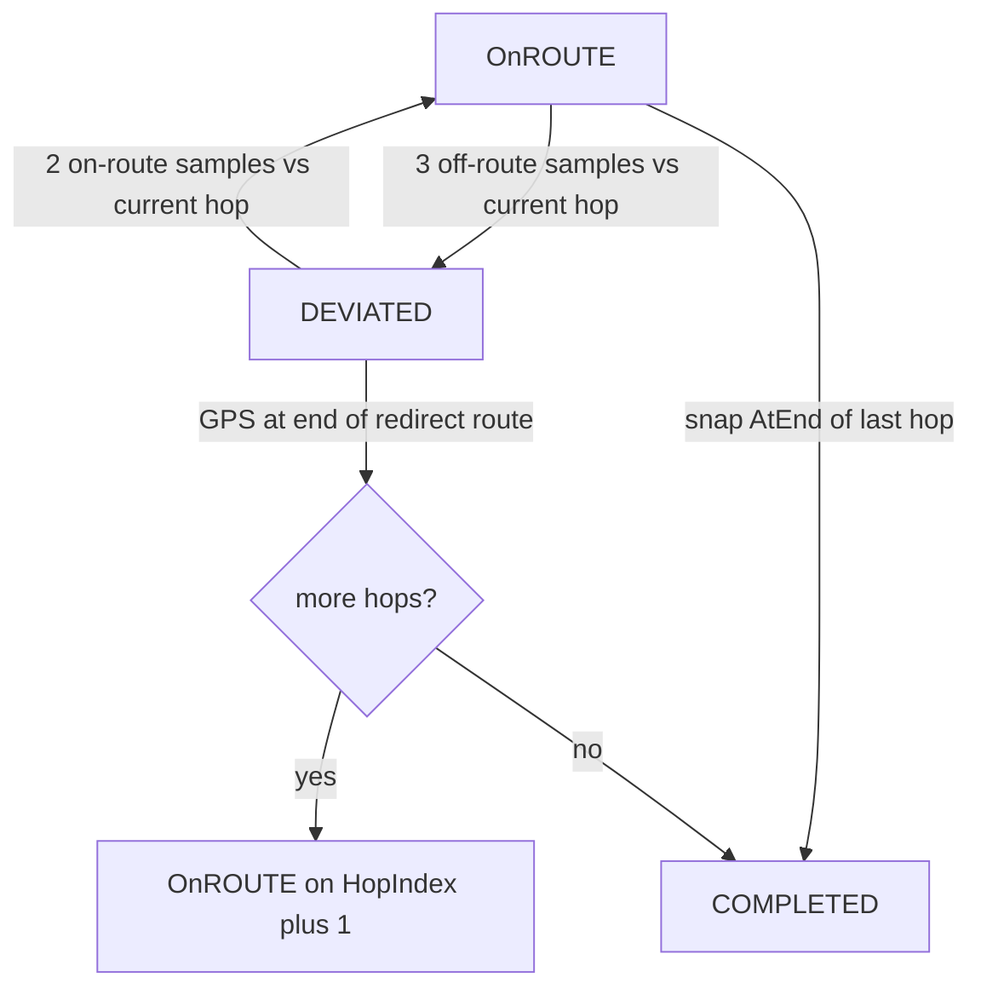

# Off-route (`DEVIATED`) and redirect

How the tracking room decides that a rider left the saved hop, what it does next, and which websocket frames the room emits. Graph planning stays in [trip route](trip-route.md). The socket runtime stays in [realtime rooms](realtime.md). This page is the live state machine only.

The client sends raw GPS. It never sends "I am off the route". The room is the authority.

## Contents

- [What the room measures](#what-the-room-measures)
- [Thresholds](#thresholds)
- [Preconditions](#preconditions)
- [Wire](#wire)
- [Situations](#situations)
- [Redirect target is the end of the current hop](#redirect-target-is-the-end-of-the-current-hop)
- [Trade-off: the room does not jump to C](#trade-off-the-room-does-not-jump-to-c)
- [Code map](#code-map)

## What the room measures

Each rider has one `HopIndex` on one assigned branch. Hop `i` is the polyline from `Stops[i]` to `Stops[i+1]`. Example: A → B → C. Hop 0 is A→B. Hop 1 is B→C.

The snap worker compares each accepted GPS sample to **that hop polyline only**. Distance over `geo.OffRouteM` (50 m) marks the sample off-route and **locks the branch cursor**. Progress and hop do not move. The rider cannot skip B because the GPS sat near C.

The room counts one sample per new snap (not per 500 ms tick). `OnROUTE` plus three consecutive off-route samples becomes `DEVIATED`. `DEVIATED` plus two consecutive on-route samples (again vs the **locked** hop) returns to `OnROUTE`.

While `DEVIATED`, the room asks Goong for a **temporary** bike route from the current GPS fix to `Stops[HopIndex+1]`. That polyline lives in room memory. It is not a `Leg` or `Travel` row.



## Thresholds

| Name | Value | Role |
| --- | --- | --- |
| `geo.OffRouteM` | 50 m | Sample is off the **current hop** polyline |
| `geo.ArriveM` | 30 m | Near the end of a polyline counts as arrived |
| `ConfirmSamples` | 3 | Consecutive off-route snaps enter `DEVIATED` |
| `ClearSamples` | 2 | Consecutive on-route snaps leave `DEVIATED` |
| `SampleMinInterval` | 900 ms | A GPS frame sooner than this is dropped |
| `LivesStart` | 3 | Lives on first join |
| `ImmuneDuration` | 30 s | After a life is spent, a new deviation does not spend another |
| `RedirectRefreshMoveM` | 40 m | Move this far from the redirect origin to recompute |
| `RedirectRefreshCooldown` | 20 s | Minimum gap between two router calls while still `DEVIATED` |
| `RedirectRetryAfter` | 10 s | One retry after a provider error |
| `RedirectTimeout` | 10 s | Bound on one Goong call |

On-tick is 500 ms. Deviation still needs three **distinct** snaps, so send GPS at least once per second.

## Preconditions

1. `POST /trips/{tripId}/travels` has stored hops. A hop with no polyline is not `Ready`. Redirect then fails with `hopNotReady`.
2. The rider has `assigned_branch_id` on a route branch.
3. The trip is `active`. The lobby refuses the socket otherwise.
4. Join the room **after** those travels exist. `LoadTripInformation` runs once when the room starts. A later compute does not update a live room.

## Wire

Client → server. Namespace `tracking`, command `position`. JSON field names on the inbound struct are Go defaults (`Lat`, `Lng`):

```json
{"type":"tracking.position","payload":{"Lat":10.775,"Lng":106.70,"BatteryPercent":80,"SignalDbm":-90}}
```

Server → room. These types use `Broadcast` (ordered). `tracking.positions` is the 500 ms batch.

| Type | When | Payload |
| --- | --- | --- |
| `tracking.positions` | Each tick that has a visible rider | `userId`, `lat`, `lng`, `batteryPercent`, `signalBars`, `driveStatus`, `connectionStatus` |
| `tracking.offRoute` | The deviated flag flips | `userId`, `deviated`, `distanceM`, `branchId`, `hopIndex`, `lives` |
| `tracking.life` | A life is spent | `userId`, `lives`, `immuneUntil`, `exhausted` |
| `tracking.redirect` | Redirect lifecycle | `userId`, `status`, `reason`, `origin`, `target`, and on `ready`: `polyline`, `distanceM`, `durationS` |

`driveStatus` on the position batch is `"OnROUTE"` or `"DEVIATED"` (enum JSON).

Redirect `status`: `pending` → `ready` → `cleared`, or `failed`.

Redirect `reason`:

| Reason | Meaning |
| --- | --- |
| `confirmed` | First route after three off-route samples |
| `refresh` | Same hop, new origin, rider moved ≥ 40 m and ≥ 20 s passed |
| `rejoined` | Two samples back on the **current hop** polyline |
| `arrivedStop` | GPS reached the end of the temporary route |
| `hopNotReady` | Current hop has no stored polyline, or no next stop |
| `providerError` | Router missing, Goong error, empty or bad polyline |

`target` is the stop at the far end of the current hop: `destinationId`, `name`, `lat`, `lng`.

## Situations

Each row is one case the room handles. "Result" is what the client must render.

### Enter and leave `DEVIATED`

| Situation | How the room handles it | Result |
| --- | --- | --- |
| GPS within 50 m of the current hop, including noise under that line | Count as on-route. Cursor may advance along the hop. | `driveStatus: OnROUTE`. No `offRoute` / `redirect` edge. |
| One or two samples > 50 m, then a sample back on the hop | Off-route counter resets. | Still `OnROUTE`. |
| Three consecutive samples > 50 m from the **current hop** | `enterDeviated`. Spend one life unless still immune. Start redirect to `Stops[HopIndex+1]`. | `driveStatus: DEVIATED`. `tracking.offRoute` with `deviated: true`. `tracking.life` if a life was spent. `tracking.redirect` `pending` then `ready` (or `failed`). |
| Same snap counted twice (no new `LastSnapAt`) | Ignore. | No new edge. |
| GPS faster than 900 ms | Drop the whole sample. | Pin stays at the last accepted fix. |
| Two consecutive samples ≤ 50 m from the **locked hop** while `DEVIATED` | `rejoin`. Clear the temporary route. Hop index does not change. | `OnROUTE`. `tracking.offRoute` `deviated: false`. `tracking.redirect` `cleared` / `rejoined`. |
| One on-route sample then off-route again while `DEVIATED` | On-route counter resets. Stay `DEVIATED`. | Redirect may refresh if move + cooldown match. |
| New deviation inside 30 s of the last life loss | Enter `DEVIATED` again. Do not spend a life. | `offRoute` + `redirect`. No `tracking.life`. |
| New deviation after immunity | Spend another life, down to 0. | `tracking.life` with `exhausted: true` at 0. Redirect still runs at 0 lives. |

### Redirect while `DEVIATED`

| Situation | How the room handles it | Result |
| --- | --- | --- |
| Router returns a polyline | Decode, build `geo.Route`, snap with a **separate** redirect cursor. | `tracking.redirect` `ready` with `polyline`, `distanceM`, `durationS`, `target`. |
| Router error or empty polyline | Mark failed. Schedule **one** retry after 10 s if `Retries == 0`. | `status: failed`, `reason: providerError`. A second failure does not retry. |
| No router mounted | Fail immediately. No retry. | `providerError`. |
| Current hop not `Ready` or no `Stops[hop+1]` | Fail immediately. No retry. | `hopNotReady`. |
| Still `DEVIATED`, moved ≥ 40 m from redirect origin, and ≥ 20 s since the last request | New generation. Keep the old route on screen until the new answer arrives. Target stays the **same stop**. | `pending` / `ready` with `reason: refresh`. |
| Stale Goong answer (generation mismatch) | Drop it. | No extra broadcast. |
| GPS follows the temporary route to its end (`ArriveM` at the last vertex) | `arriveByRedirect`. Clear redirect. If another hop exists, set `HopIndex` to `Redirect.Hop + 1` and start snap there. Else `COMPLETED`. | `offRoute` `deviated: false`. `redirect` `cleared` / `arrivedStop`. Then `OnROUTE` on the next hop, or `COMPLETED`. |
| GPS is near hop B→C but still `HopIndex == 0` (A→B) | Still off-route vs A→B. Redirect target stays **B**. See [trade-off](#trade-off-the-room-does-not-jump-to-c). | `ready` target is B, not C. |

### Stay, complete, ignore

| Situation | How the room handles it | Result |
| --- | --- | --- |
| Leader starts stay | Save `ResumeDrive`. Zero sample counters. Overlay `StayPrivate`. | Deviation does not run (`TripStay`). A `DEVIATED` rider stays `DEVIATED` under the overlay. |
| Leader ends stay | Restore `ResumeDrive`. | A rider who was `DEVIATED` is `DEVIATED` again. Redirect drain still runs every tick during stay. |
| `STOP`, `StayPrivate`, `COMPLETED` | No snap, no deviation. | Omitted from `tracking.positions` except stay-public during stay. |
| Every joined rider `COMPLETED` | `markTripComplete`. | Trip status `completed`. |

## Redirect target is the end of the current hop

`nextStop(branch, hop)` returns `Stops[hop+1]`.

| Locked hop | Stops | Redirect destination |
| --- | --- | --- |
| 0 | A, B, C | B |
| 1 | A, B, C | C |

Refresh does not change that column. Arrival on the temporary route is what advances the hop. On-route snap `AtEnd` also advances the hop, and only while the sample is **on** the current polyline.

## Trade-off: the room does not jump to C

**Situation.** Rider leaves A→B (`HopIndex = 0`). GPS then sits on or beside the B→C road.

**Complication.** A product instinct is "they already skipped B, so redirect to C".

**Question.** Does this room retarget to C?

**Answer. No.** The current design does not match later hops while the rider is off-route. The cursor stays on hop 0. The redirect destination stays B.

That is a **trade-off on what the server is willing to certify**, not a Goong limit.

| If the room jumped to C | If the room stays on B (today) |
| --- | --- |
| GPS near the next polyline can skip stop B | Stop B is still required |
| Progress can claim a hop the rider did not ride | Progress cannot skip a checkpoint from a noisy fix |
| Lives and arrival for B become ambiguous | B is only cleared by riding A→B on-route, or by finishing the redirect to B |

The lock exists because an off-route sample that still snaps onto the line can drag `seg` / `progress` to the end of A→B and step hop 1. The rider would "arrive" at B from a point that is not on A→B.

**Not a bug in the current spec.** Treat skip-to-C as a later change of law, for example:

- while `DEVIATED`, also snap hops ahead of `HopIndex`, and promote hop after N samples on that later polyline, or
- pick the nearest remaining stop as the redirect target.

Either rule must say what happens to stop B (visited, skipped, or still required). Until that rule exists, clients must draw the temporary route **to B** even when the map pin is already near C.

## Code map

| Piece | File |
| --- | --- |
| Thresholds | `module/tracking/engine/Deviation.go`, `module/tracking/geo/Route.go` |
| Branch lock and redirect cursor | `module/tracking/engine/PendingPosition.go` |
| Room state machine | `module/tracking/Deviation.go` |
| Goong adapter (no leg cache) | `module/maps/service/RedirectService.go` |
| Outbound types | `module/tracking/model/message/Outbound.go` |
| Tick + stay overlay | `module/tracking/OnTick.go`, `module/tracking/OnMessage.go` |
